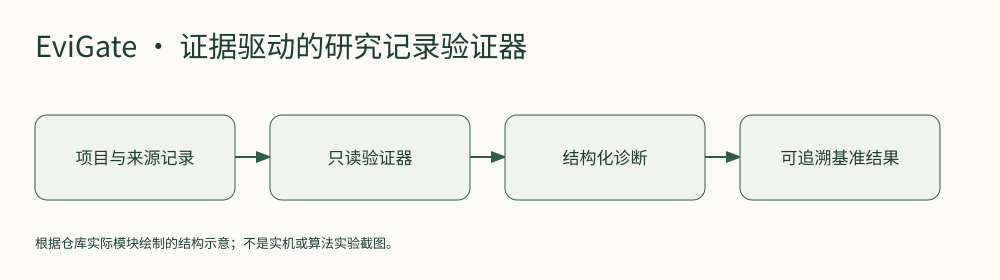

# EviGate

**把研究项目的证据、运行记录与论断，变成可检查的数据约定。**



EviGate 是一组 Python 只读验证器与参考控制器，检查项目阶段、来源证明、运行清单、冻结变更、论断引用和基准数据包，并返回稳定的错误码。适合需要让实验过程可追溯的研究脚手架、Agent工作流或课程项目。它不会代替研究判断，也不会自动证明论文结论。

## 技术栈

- Python 3.12+，PyYAML；pytest用于开发测试。
- `src/evigate`包括记录模型、验证、打分、参考控制器与命令行。
- 本次从新虚拟环境实际安装；30项现有回归通过，阶段记录CLI返回无诊断。没有调用真实模型或付费服务。

## 快速上手

```sh
git clone https://github.com/yangwei251003/evigate.git
cd evigate
python -m venv .venv
```

Windows运行`.venv\Scripts\python -m pip install .`，macOS/Linux运行`.venv/bin/python -m pip install .`。安装后调用同目录下的`evigate`命令，或使用虚拟环境的Python：

```sh
python -m evigate.cli --help
python -m evigate.cli validate-project-state PROJECT_STATE.yaml
```

请先激活虚拟环境，或把示例中的python换成其完整路径。命令返回JSON诊断：0表示该项检查未发现问题，2表示记录不符合约定，3表示输入无法读取。检查不会向记录写入审批，也不覆盖现有正式输出。

开发测试：安装`pytest`后运行`python -m pytest -q`。源代码模式下子进程测试需要先安装包，或把`src`加入PYTHONPATH。

## 功能与目录

| 目录 | 内容 |
|---|---|
| `src/evigate/` | 验证器、参考控制器、评分和CLI |
| `tests/` | 记录错误、状态门槛、命令行和正式运行边界回归 |
| `benchmark/`、`configs/` | 已有公开基准数据包、协议和冻结配置 |
| `runs/`、`analysis/` | 历史公开试验结果与分析材料 |
| `phases/`、`protocol/` | 逐阶段记录和研究约定 |
| `paper/`、`claims/` | 原作者文稿及论断追溯，不作为第三方独立验真 |

## 状态、许可与计划

原项目状态文件记录阶段09归档完成；本次验证的是公开源码的安装、CLI和30项回归，历史量化结果以原记录的来源与限制为准。未做新的学术有效性或外部模型评价。

自有代码Apache-2.0，原创文档与基准材料按来源登记使用CC BY 4.0；第三方依赖保留原许可，见`LICENSE_AND_ATTRIBUTION.md`。私人配置、认证、PDF与个人遥测不随源码发布。

2026-10-26：补公开安装指南、结构图与验证说明。后续可扩展领域适配器与更明确的错误提示；迁移没有替代已有阶段审批。
